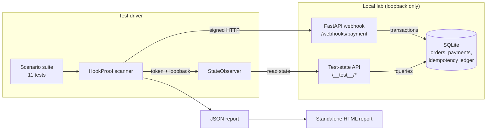

# HookProof

[](https://github.com/Nikhil-133/HookProof/actions/workflows/ci.yml)
[](LICENSE)
[](pyproject.toml)

**HookProof** is a CLI-first webhook security testing tool. It tests whether a
webhook handler securely processes incoming events, and its differentiator is
**EffectProof**: it inspects the *actual application state* after each test
instead of trusting HTTP response codes alone.

> Delivering a payment webhook twice must not fulfil the payment twice. Rejecting
> a forged event must not change protected state. HookProof proves this by
> observing the database behind the handler.

The project ships with a small, self-contained **payment webhook lab** that runs
in two modes:

* `vulnerable` – intentionally insecure (accepts unsigned events, replays
  duplicates). **For an isolated local lab only.**
* `secure` – verifies signatures, authenticates timestamps, validates payloads
  and enforces concurrency-safe idempotency.

Everything uses **synthetic data only**. No real payment systems or credentials
are ever involved.

> The CI workflow runs the full test matrix (Ubuntu 3.11/3.13, Windows 3.14)
> plus a ruff lint/format gate. See [Continuous integration](#continuous-integration).

## Table of contents

1. [Features](#features)
2. [Architecture](#architecture)
3. [Project layout](#project-layout)
4. [Requirements](#requirements)
5. [Setup (Windows PowerShell)](#setup-windows-powershell)
6. [Setup (Linux / macOS)](#setup-linux--macos)
7. [Quick start](#quick-start)
8. [The webhook protocol](#the-webhook-protocol)
9. [EffectProof](#effectproof)
10. [The core test suite](#the-core-test-suite)
11. [Reports](#reports)
12. [Running the tests](#running-the-tests)
13. [Continuous integration](#continuous-integration)
14. [Configuration](#configuration)
15. [Safety model and limitations](#safety-model-and-limitations)
16. [Security and threat model](#security-and-threat-model)

---

## Features

* `hookproof lab serve --mode vulnerable|secure` – an isolated FastAPI lab with a
  SQLite-backed synthetic payment application.
* `hookproof scan --target ... --suite core` – runs an **11-test** security suite.
* **EffectProof** state verification through a restricted, token-protected,
  loopback-only test-state interface.
* Concurrent-delivery test proving idempotency at the database level, not just
  in the response body.
* Severity assigned by demonstrated business impact; findings include
  remediation guidance.
* Evidence-backed **JSON** and **standalone HTML** reports (`--report`,
  `--html`). The HTML output is one self-contained file with embedded styles and
  no CDN or script dependencies.
* A colored Rich terminal UI with a live scan progress animation, plus an
  optional `hp` PowerShell launcher with a boot banner.
* **39 automated tests** (unit + end-to-end against both lab modes) with
  branch coverage enabled (`pytest-cov`).
* CI matrix on Linux and Windows with a ruff lint/format gate.

---

## Architecture



The scanner sends requests like a payment provider would, then reads the
resulting state through the test-only interface. A finding is confirmed only
when the observed state violates the expected invariant.

---

## Project layout

```text
HookProof/
├── src/hookproof/
│   ├── __init__.py
│   ├── cli.py              # Typer CLI (lab serve / scan / version)
│   ├── config.py           # env vars, .env loader, secret redaction
│   ├── signatures.py       # HMAC-SHA256 signing + freshness helpers
│   ├── scanner.py          # target validation + suite orchestration
│   ├── state_observer.py   # EffectProof state client
│   ├── reports.py          # JSON/terminal report model
│   ├── html_report.py      # standalone HTML renderer (no external assets)
│   ├── ui.py               # Rich-based colored terminal UI
│   ├── scenarios/
│   │   ├── base.py         # scenario framework and invariants
│   │   └── core.py         # the 11 core security tests
│   └── lab/
│       ├── app.py          # FastAPI vulnerable/secure app
│       ├── db.py           # SQLite persistence + idempotency
│       └── protocol.py     # shared webhook protocol definition
├── tests/                  # pytest unit + integration tests
├── .github/workflows/      # CI matrix + lint job
├── reports/                # generated JSON/HTML reports (gitignored)
├── data/                   # generated SQLite databases (gitignored)
├── docs/                   # protocol, threat model + labelled sample reports
├── start.ps1               # optional PowerShell onboarding banner + venv activation
├── pyproject.toml
├── README.md
├── SECURITY.md
├── LICENSE
├── .gitignore
└── .env.example
```

---

## Requirements

* Python **3.11+**
* No database server required (SQLite is embedded)

Dependencies: `typer`, `fastapi`, `uvicorn`, `httpx`, `rich`.
Development extras: `pytest`, `pytest-cov`, `ruff`.

---

## Setup (Windows PowerShell)

```powershell
# From the HookProof directory
python -m venv .venv
.\.venv\Scripts\Activate.ps1
python -m pip install --upgrade pip
pip install -e ".[dev]"
```

If script execution is blocked, run once:

```powershell
Set-ExecutionPolicy -Scope Process -ExecutionPolicy Bypass
```

## Setup (Linux / macOS)

```bash
# From the HookProof directory
python3 -m venv .venv
source .venv/bin/activate
python -m pip install --upgrade pip
pip install -e ".[dev]"
```

---

## Quick start

Use **two terminals**. Terminal 1 runs a lab; Terminal 2 runs the scanner.

### 1. Run the vulnerable lab

```powershell
hookproof lab serve --mode vulnerable --host 127.0.0.1 --port 8000
```

### 2. Scan it

```powershell
hookproof scan --target http://127.0.0.1:8000/webhooks/payment --suite core --report reports/report.json
```

You will see a terminal summary with `Outcome: FAIL` and **nine findings**:

| Finding | Severity |
| --- | --- |
| unsigned events accepted | HIGH |
| forged signatures accepted | HIGH |
| payload tampering accepted | HIGH |
| unsupported event types processed | MEDIUM |
| negative amounts processed | HIGH |
| duplicate fulfilment | HIGH |
| concurrent duplicate fulfilment | CRITICAL |
| event ID reused across orders | HIGH |
| stale timestamps accepted | MEDIUM |

Each finding is confirmed by the synthetic database state, not just the HTTP
status code. The process exits with code `1` when failures are found.

### 3. Switch to the secure lab and rerun

Stop the vulnerable lab (Ctrl+C), then:

```powershell
hookproof lab serve --mode secure --host 127.0.0.1 --port 8000
```

In Terminal 2:

```powershell
hookproof scan --target http://127.0.0.1:8000/webhooks/payment --suite core `
  --report reports/report_secure.json --html reports/report_secure.html
```

Now the outcome is `PASS` (exit code `0`) and all 11 tests pass.

### 4. Open the HTML report

`--html` writes a single portable file. Open it directly in a browser:

```powershell
Start-Process reports/report_secure.html
```

A committed example of each mode lives in `docs/sample_report_vulnerable.html`
and `docs/sample_report_secure.html`.

> Tip: run `hookproof version` to confirm installation, and
> `hookproof --help` / `hookproof scan --help` for usage.

### Optional: `hp` launcher (Windows PowerShell)

`start.ps1` shows a colored banner, activates the virtual environment and prints
quick-start commands. Add this once to your PowerShell profile (`$PROFILE`):

```powershell
function hp {
    param([switch]$NoAnimation)
    . "C:\Users\Nikhil kumar\OneDrive\Documents\Default Project\HookProof\start.ps1" -NoAnimation:$NoAnimation
}
```

Then `hp` drops you into the project, ready to scan. Use `hp -NoAnimation` to
skip the short boot animation. The CLI UI is ASCII-safe and works in legacy
Windows consoles as well as Windows Terminal.

---

## The webhook protocol

Both lab modes implement the same documented protocol, so HookProof can test
them identically.

| Item | Value |
| --- | --- |
| Endpoint | `POST /webhooks/payment` |
| Signature header | `X-HookProof-Signature: sha256=<hex>` |
| Timestamp header | `X-HookProof-Timestamp: <unix seconds>` |
| Signed bytes | `<timestamp>.<raw body>` |
| Algorithm | HMAC-SHA256 with the shared secret |

Example body:

```json
{
  "event_id": "evt-abc",
  "type": "payment.succeeded",
  "order_id": "ord-abc",
  "amount": 1000,
  "currency": "usd",
  "timestamp": 1730000000
}
```

The timestamp is part of the signed bytes, so a captured signature cannot be
replayed with a different timestamp. See `docs/lab_protocol.md`.

### Restricted test-state interface

EffectProof reads state through a separate, protected interface:

| Endpoint | Purpose |
| --- | --- |
| `GET /__test__/health` | verify access + mode |
| `GET /__test__/orders/{order_id}` | payment count, total, status |
| `GET /__test__/state` | aggregate counters |
| `POST /__test__/reset` | clear synthetic data |

It requires the `X-HookProof-Test-Token` header and refuses any client that is
not on a loopback address (HTTP 403).

---

## EffectProof

For every test, HookProof:

1. generates a unique synthetic order/event ID,
2. records the initial state through the test-state interface,
3. sends the webhook request(s),
4. observes the HTTP response **and** the resulting application state,
5. compares the observed change with the expected security invariant,
6. reports `PASS`, `FAIL` or `ERROR` with evidence.

A duplicate delivery may legitimately receive `200 OK` if the application safely
recognises the event as already processed. HookProof judges the test by the
**expected state change**, not by the status code.

**Limitation:** internal effects can only be observed when the target exposes a
suitable test-state interface (the HookProof lab does). Against an arbitrary
API without such instrumentation, HookProof reports response-level behaviour and
must not claim to have verified internal state.

---

## The core test suite

| # | ID | Expected invariant |
| --- | --- | --- |
| 1 | `valid_signature` | Valid signed event processes exactly once |
| 2 | `missing_signature` | Unsigned event causes no protected side effect |
| 3 | `invalid_signature` | Forged signature rejected, no side effect |
| 4 | `payload_tampering` | Modified signed content not processed |
| 5 | `unsupported_event_type` | Unsupported event type does not move money |
| 6 | `invalid_amount` | Negative amount rejected without side effects |
| 7 | `duplicate_event` | Repeated delivery → one business operation |
| 8 | `concurrent_duplicate` | 8 simultaneous copies → one business operation |
| 9 | `event_id_reuse` | Event ID cannot be reused for another order |
| 10 | `stale_timestamp` | Event outside freshness window rejected |
| 11 | `malformed_payload` | Invalid JSON / missing fields → no state change |

On the vulnerable lab, tests **2, 3, 4, 5, 6, 7, 8, 9 and 10 FAIL**, each
confirmed by real database effects. On the secure lab all eleven **PASS**. The
`valid_signature` test is the control: if it fails, the target is not processing
legitimate events correctly and the other results should be treated with
caution.

---

## Reports

A JSON report is written wherever `--report` points, and a standalone HTML report
wherever `--html` points (default examples live in `reports/`, gitignored).

The **JSON** report contains:

* `summary` – totals, passed/failed/errors, outcome, highest severity, request
  count and duration;
* `results` – per-test status, expected vs observed behaviour, evidence
  (redacted HTTP exchanges + before/after state), notes and remediation;
* `limitations` – explicit scope boundaries of the run.

The **HTML** report renders the same data as a single self-contained file:

* summary cards, outcome banner and severity badges;
* expandable evidence per finding (HTTP exchanges and state snapshots);
* print-friendly styling;
* no CDN, no JavaScript and no external fonts, so it works offline;
* every target-supplied value is HTML-escaped to prevent report injection.

Secrets are never written to reports. Labelled samples generated by real runs
are committed under `docs/`:

| File | Result |
| --- | --- |
| `docs/sample_report_vulnerable.json` | `FAIL` – 9 findings |
| `docs/sample_report_vulnerable.html` | same run, standalone HTML |
| `docs/sample_report_secure.json` | `PASS` – 11/11 |
| `docs/sample_report_secure.html` | same run, standalone HTML |

Exit codes: `0` = PASS, `1` = FAIL (confirmed findings), `2` = INCONCLUSIVE or
an operational/usage error such as a rejected target.

---

## Running the tests

```powershell
# Windows PowerShell (venv active)
pytest
pytest --cov=hookproof --cov-report=term-missing
```

```bash
# Linux / macOS
pytest
pytest --cov=hookproof --cov-report=term-missing
```

The suite starts real loopback lab servers and exercises the vulnerable and
secure modes end to end. It covers signing, replay protection, payload
validation, unsupported events, amount validation, event-ID reuse, duplicate
delivery and concurrent delivery. Current status: **39 passed**, **87% branch
coverage**.

---

## Continuous integration

`.github/workflows/ci.yml` runs on every push and pull request:

| Job | Environment | What it does |
| --- | --- | --- |
| `test` | Ubuntu, Python 3.11 | full suite + coverage |
| `test` | Ubuntu, Python 3.13 | full suite + coverage, uploads `coverage.xml` |
| `test` | Windows, Python 3.14 | full suite + coverage |
| `lint` | Ubuntu, Python 3.13 | `ruff check .` and `ruff format --check .` |

All jobs use `pip` caching and the tests use `--strict-markers`, so an
unregistered marker fails instead of being silently skipped.

Run the same gates locally:

```powershell
ruff check .
ruff format --check .
pytest --cov=hookproof --cov-report=term-missing
```

---

## Configuration

Environment variables (see `.env.example`):

| Variable | Purpose | Dev default |
| --- | --- | --- |
| `HOOKPROOF_WEBHOOK_SECRET` | HMAC signing secret | `dev-webhook-secret-change-me` |
| `HOOKPROOF_TEST_TOKEN` | Test-state bearer token | `dev-test-token-change-me` |
| `HOOKPROOF_FRESHNESS_WINDOW` | Accepted timestamp window (s) | `300` |
| `HOOKPROOF_LAB_HOST` / `HOOKPROOF_LAB_PORT` | Default bind | `127.0.0.1` / `8000` |

Copy `.env.example` to `.env` and change the secrets for anything beyond the
demo. The default development values exist only so a beginner can run the lab
immediately.

---

## Safety model and limitations

**Safety**

* The scanner only targets **explicitly allowed hosts**; the default allow-list
  is loopback (`127.0.0.1`, `::1`, `localhost`). Public IPs, arbitrary domains
  and third-party endpoints are refused.
* The webhook lab uses **synthetic data only** and never contacts a real payment
  system.
* `lab serve` refuses to bind to a non-loopback address.
* The test-state interface is loopback-only and token-protected.
* Request timeouts and a request budget (`--max-requests`) are enforced.
* Signing secrets and tokens are never logged or written to reports.

**Limitations**

* EffectProof requires a test-state interface or equivalent instrumentation.
* The MVP supports one event type (`payment.succeeded`) and one suite (`core`).
* Race detection is probabilistic: a clean concurrent test does not prove the
  absence of a race under all conditions.
* The `vulnerable` mode is intentionally insecure and must never be exposed
  beyond an isolated local lab.

---

## Security and threat model

* Full threat model: [`docs/threat_model.md`](docs/threat_model.md) – assets,
  trust boundaries, attacker capabilities, invariants and residual risk.
* Vulnerability reporting: [`SECURITY.md`](SECURITY.md). Please report privately
  through GitHub security advisories, not in a public issue.
* This project is for **authorised testing only**. Only scan systems you own or
  have written permission to test; the loopback allow-list is a safety rail, not
  legal authorisation.

---

## License

MIT. See [`LICENSE`](LICENSE). Educational and defensive security use.
